# GéoEmploi


Service public (fictif) de recherche d'emploi géolocalisée, pour le « Ministère du Job et Bonheur » : une carte des offres consultable sans compte, et des espaces pour les chercheurs d'emploi, les employeurs et l'administration.

> [!WARNING]
> Projet réalisé à **Epitech** (G-SVR-500 « Survivor »). Ne recopie pas ce code tel quel pour ton propre projet : ça ne t'apprendra rien, et c'est détecté.

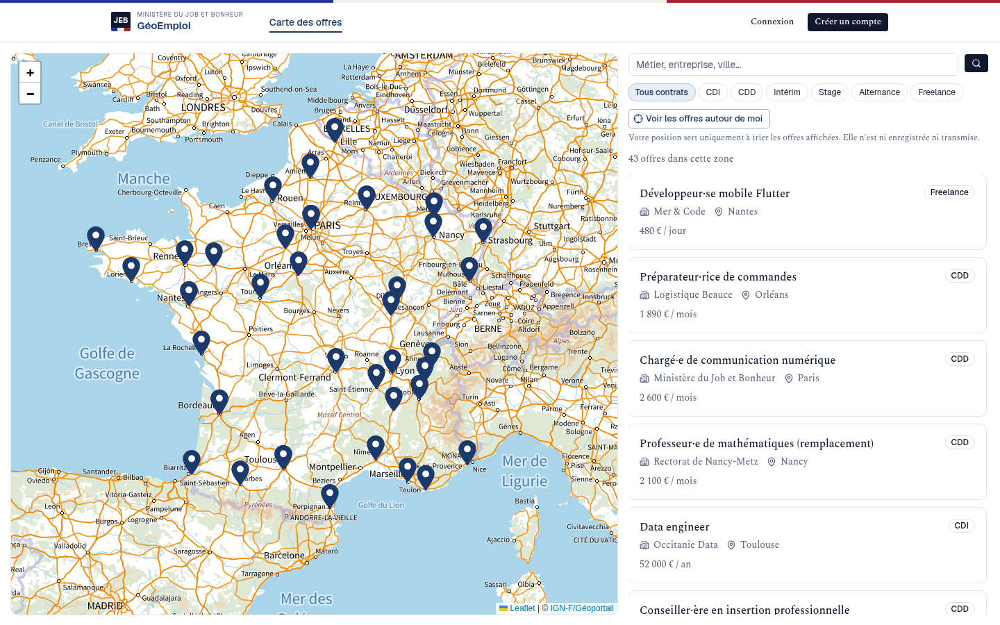

| Dossier            | Rôle                                                       | Port |
| ------------------ | ---------------------------------------------------------- | ---- |
| `geo-emploi-db`    | PostgreSQL + migrations Alembic générées depuis les modèles | 5555 |
| `geo-emploi-back`  | API REST FastAPI : auth, offres, candidatures, modération   | 1234 |
| `geo-emploi-front` | Next.js 16 : carte publique et espaces des trois rôles      | 3000 |

Fonctionnement interne, endpoints et points du sujet couverts : [docs/ARCHITECTURE.md](docs/ARCHITECTURE.md).

## Prérequis

- **Docker** avec **Compose v2** (`docker compose`) : suffisant pour tout lancer.
- Pour lancer service par service : **Python 3.12+** et **Node.js 20.9+** (npm).

## Démarrage avec Docker

```bash
./rundocker.sh
```

Ou à la main :

```bash
docker compose up --build -d
docker compose run --rm api python -m app.seed --reset   # jeu de démonstration
```

- Front : http://localhost:3000
- API : http://localhost:1234 (doc interactive : http://localhost:1234/docs)

> [!NOTE]
> PostgreSQL est exposé sur le port **5555** pour ne pas gêner un PostgreSQL local sur 5432. `docker compose down -v` arrête la pile **et efface la base**.

## Démarrage service par service

```bash
# 1. Base
docker run -d --name geo-emploi-pg \
  -e POSTGRES_USER=admin -e POSTGRES_PASSWORD=admin -e POSTGRES_DB=geo_emploi \
  -p 5555:5432 -v geo-emploi-pgdata:/var/lib/postgresql/data postgres:16

# 2. Migrations
cd geo-emploi-db
python3 -m venv .venv && .venv/bin/pip install -r requirements.txt
cp .env.example .env
.venv/bin/alembic upgrade head

# 3. API
cd ../geo-emploi-back
python3 -m venv .venv && .venv/bin/pip install -r requirements.txt
cp app/.env.example app/.env
.venv/bin/python -m app.seed --reset
.venv/bin/uvicorn app.main:app --port 1234 --reload

# 4. Front
cd ../geo-emploi-front
npm install
cp .env.example .env.local
npm run dev
```

## Comptes de démonstration

> [!TIP]
> Créés par `app/seed.py` (42 entreprises, 44 offres dans toute la France). Mot de passe commun : **`geoemploi2026`**.

| Rôle               | Adresse                                  |
| ------------------ | ---------------------------------------- |
| Administration     | `jeb@job-et-bonheur.fr`                  |
| Chercheur d'emploi | `camille.aubert@example.fr`              |
| Employeur          | `recrutement@rhone-numerique.example.fr` |

## Captures

| Offre | Profil chercheur d'emploi |
| --- | --- |
| 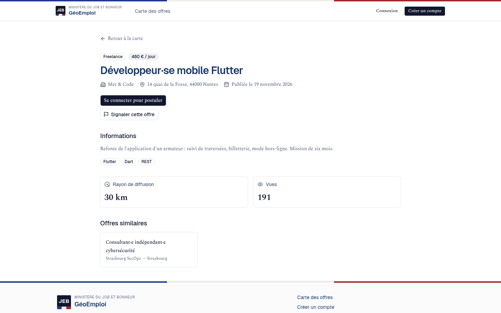 | 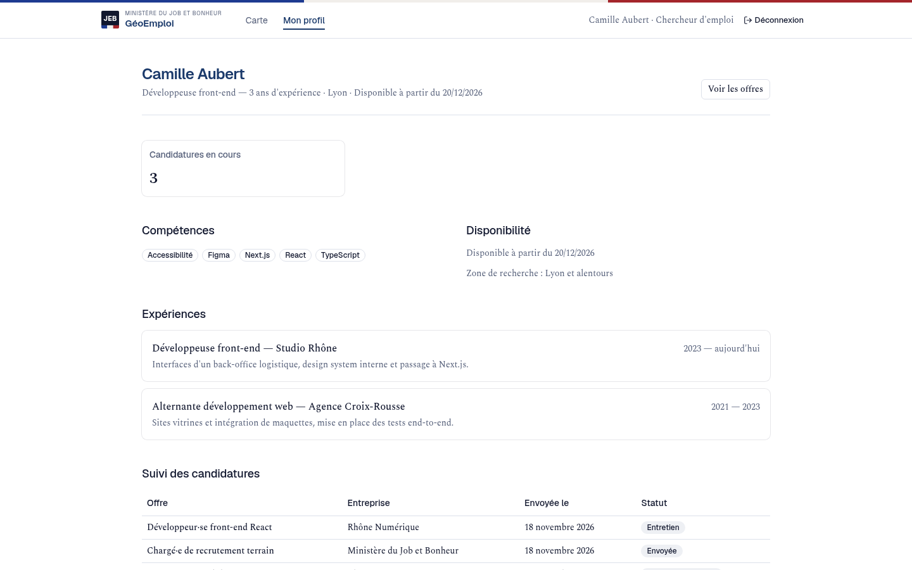 |
| **Espace employeur** | **Publier une offre** |
| 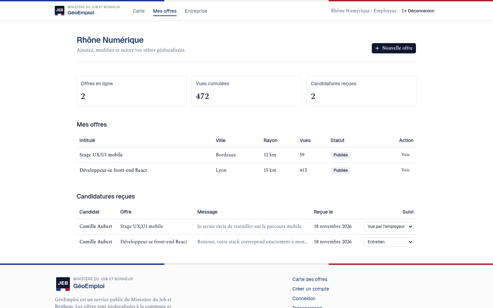 | 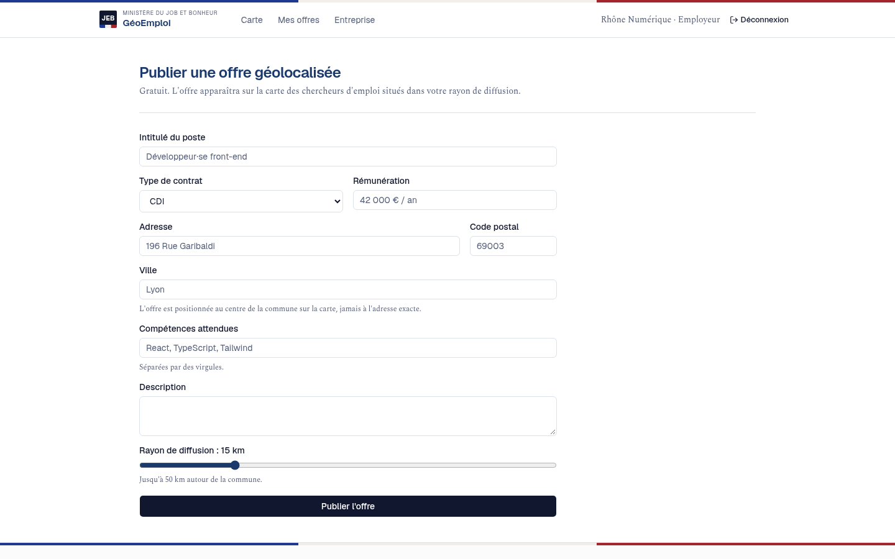 |
| **Administration** | **Signalements** |
| 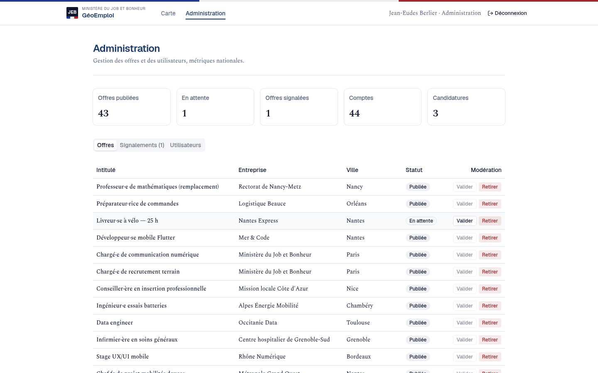 | 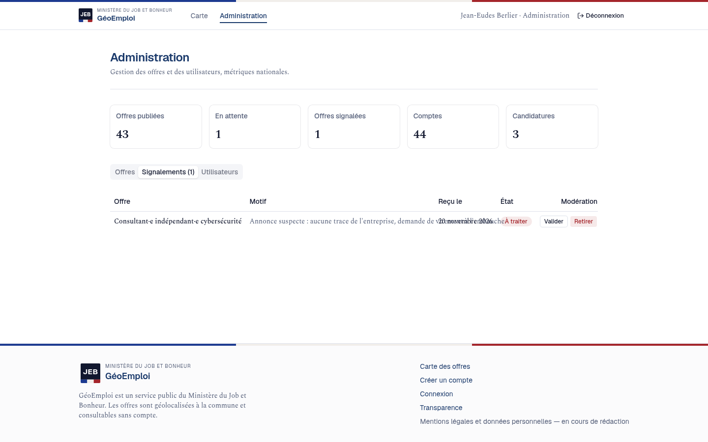 |

<details>
<summary>Plus de captures (accueil, connexion, profil entreprise, mobile)</summary>

| Accueil | Connexion |
| --- | --- |
| 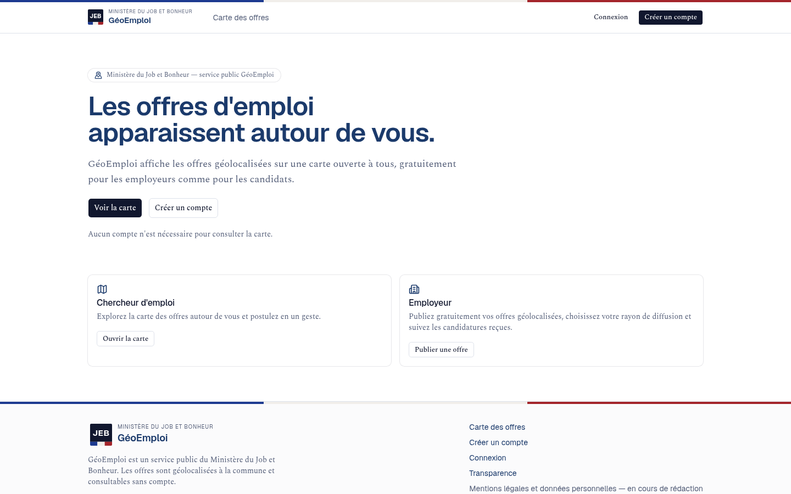 | 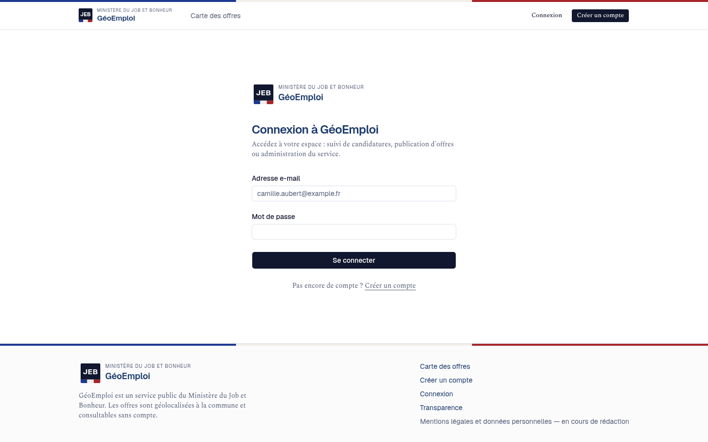 |
| **Profil entreprise** | **Mobile** |
| 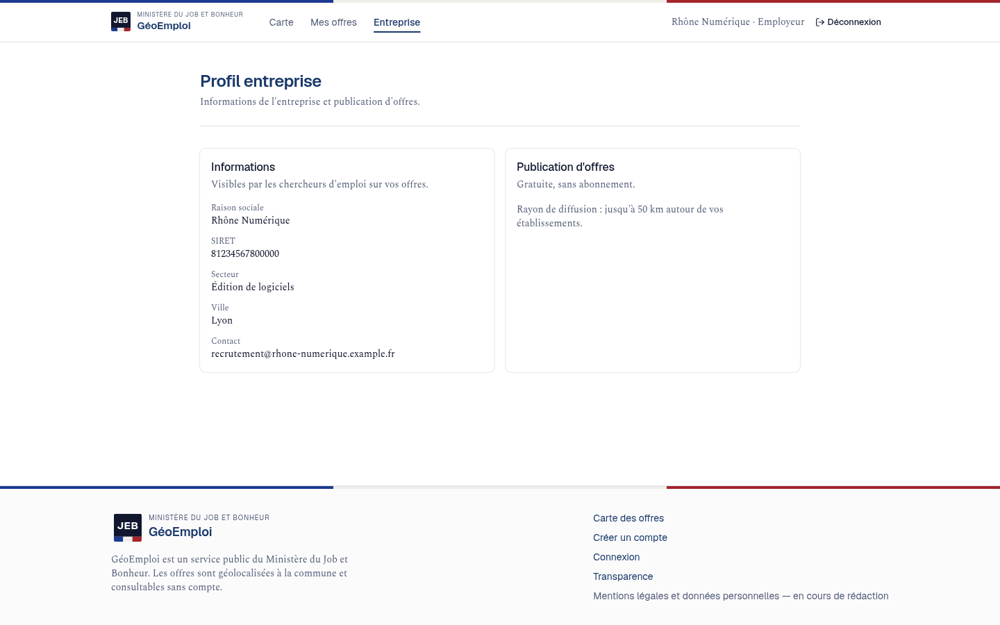 | 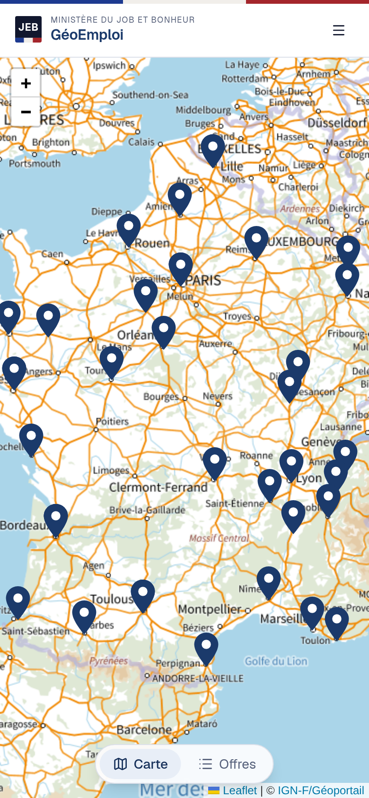 |

</details>

## Contributeurs

| | |
| --- | --- |
| Valentin Guinet | [@VivicatcHub](https://github.com/VivicatcHub) |
| Pierre Riss | [@pierreRISS](https://github.com/pierreRISS) |
| Léo Morat | [@someone3332](https://github.com/someone3332) |
| Romain Simonet | [@Romain-Simonet](https://github.com/Romain-Simonet) |

Commits au format `[TAG] message`, avec `ADD` (ajout), `MOD` (modification), `FIX` (correction), `DEL` (suppression) ou `MRG` (merge).

## Licence

Réutilisation libre, y compris commerciale, à condition de mentionner **Vivicaty** : voir [LICENSE.md](LICENSE.md).
