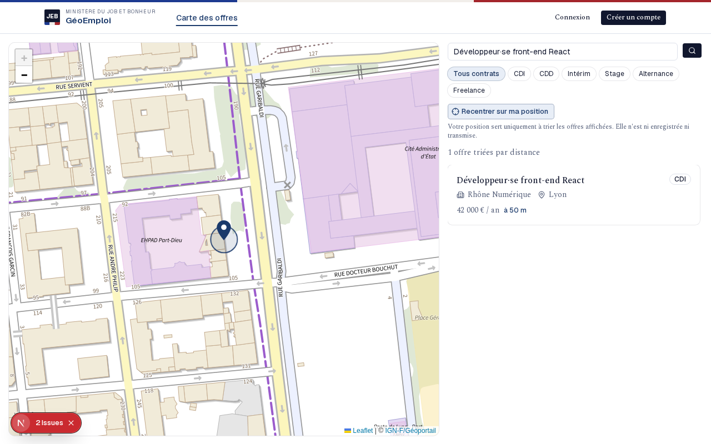
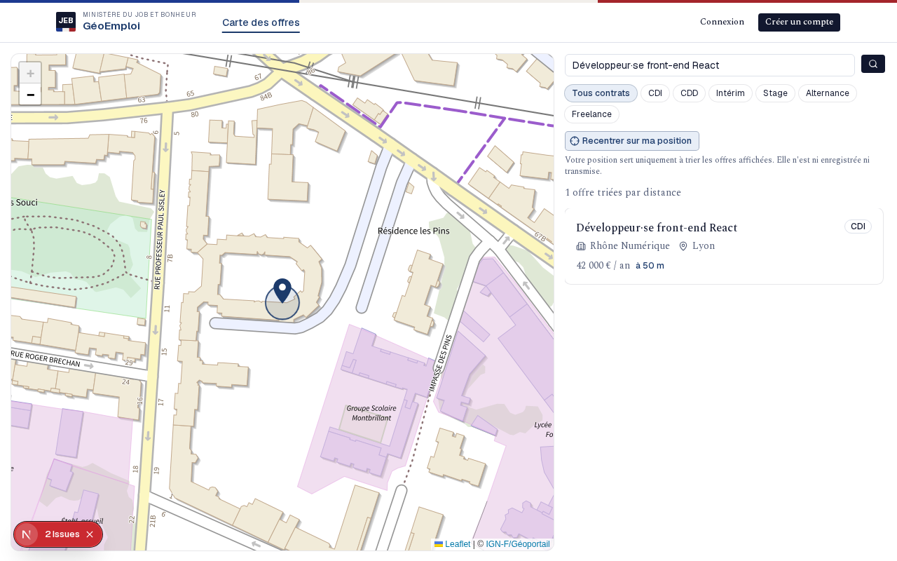

# Architecture

← [Retour au README](../README.md)

## Comment les trois tiers se parlent

```
navigateur ──► Next.js (serveur) ──► FastAPI ──► PostgreSQL
            ▲                    ▲            ▲
    cookie httpOnly    cookie relayé    migrations Alembic
                                        générées depuis app/models/
```

| Principe | En pratique |
| --- | --- |
| **Les modèles sont la source de vérité du schéma** | Le schéma est décrit une fois, en SQLModel (`geo-emploi-back/app/models/`). Les migrations en sont dérivées (`alembic revision --autogenerate`), jamais écrites à la main. Le backend n'appelle jamais `create_all`. Un `--autogenerate` qui ne détecte rien prouve que base et modèles concordent. |
| **Le navigateur ne parle jamais au backend** | Server Components, Server Actions et Route Handlers appellent l'API et relaient le cookie de session. `API_URL` n'est pas dans le bundle, pas de CORS à négocier, le JWT reste dans un cookie `httpOnly` (§3.1 du sujet). |
| **Un vocabulaire par étage, deux frontières** | La base parle français (`statut = 'envoyee'`), l'API répond en camelCase avec les valeurs du contrat (`sent`), l'écran affiche des libellés. Traductions : `app/serializers.py` (base → API) et `lib/labels.ts` (API → écran). `app/schemas.py` et `lib/schemas.ts` décrivent les mêmes objets. |

> [!IMPORTANT]
> L'autorisation est vérifiée **trois fois**, volontairement : `proxy.ts` (optimiste, sur le cookie seul), `lib/dal.ts` (au rendu de la page) et le backend (qui tranche). Une Server Action est un endpoint POST public : masquer un bouton n'autorise rien.

## Endpoints

| Méthode  | Chemin                                | Accès              |
| -------- | ------------------------------------- | ------------------ |
| `POST`   | `/api/v1/register`, `/api/v1/login`   | public             |
| `POST`   | `/api/v1/logout`                      | public             |
| `GET`    | `/api/v1/me`                          | connecté           |
| `DELETE` | `/api/v1/deleteaccount`               | connecté (RGPD)    |
| `GET`    | `/api/v1/offers`, `/api/v1/offers/:id`| **public** (§2.2)  |
| `POST`   | `/api/v1/offers`                      | employeur          |
| `POST`   | `/api/v1/offers/:id/apply`            | chercheur d'emploi |
| `POST`   | `/api/v1/offers/:id/report`           | **public** (§5)    |
| `GET`    | `/api/v1/seeker/profile`, `/applications` | chercheur      |
| `GET`    | `/api/v1/employer/company`, `/offers`, `/applications` | employeur |
| `PATCH`  | `/api/v1/employer/applications/:id`   | employeur (la sienne) |
| `GET`    | `/api/v1/admin/offers`, `/users`, `/reports`, `/metrics` | admin |
| `PATCH`  | `/api/v1/admin/offers/:id`, `/users/:id` | admin           |

La recherche accepte `?q=`, `?contract=` et un cadre de carte `?minLat=&maxLat=&minLng=&maxLng=` : la carte l'appelle (débouncé) à chaque déplacement, via le BFF `app/api/offres/route.ts`.

## Points du sujet couverts

| § | Exigence | Où |
| --- | --- | --- |
| 2.2 | Carte sans compte | `/offres` n'est pas dans le matcher de `proxy.ts` |
| 2.2 | Candidature authentifiée | Server Action **et** `CheckSeeker` côté API |
| 2.2 | Archivage à 30 jours | Colonne `archivee_le`, balayage au démarrage de l'API, filtre sur la date dans la recherche |
| 3.2 | Précision à la commune | `app/geocoding.py` recalcule la position au centroïde de la commune (`code_insee`, API Adresse) à chaque publication |
| 3.3 | RGPD | Suppression réelle du compte (confirmation par saisie de l'e-mail), `ON DELETE CASCADE` sur profils, offres et candidatures, `SET NULL` sur l'auteur d'un signalement, position jamais persistée |
| 5 | Signalement | Ouvert aux visiteurs anonymes, remonté dans l'onglet « Signalements » de l'administration |

### Recentrage des offres existantes (§3.2)

Les offres publiées avant le passage à la maille commune ont été reprises une fois par `python -m app.recentrer_offres` (**irréversible**) : 44 offres examinées, 44 recentrées, 0 non résolue, déplacement moyen d'environ 1,5 km. La commande est rejouable : relancée, elle ne déplace plus rien.

| Avant (position à la rue) | Après (centroïde de la commune) |
| --- | --- |
|  |  |
